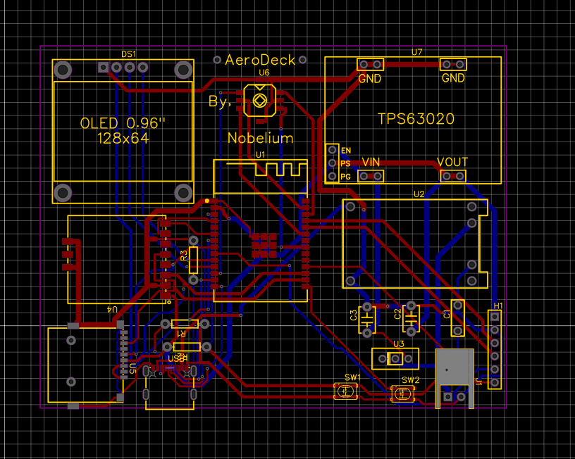

# AeroDeck
A compact, custom-designed handheld wireless and RF auditing tool built around the ESP32-C5-WROOM-1 module and sub-1GHz radio modules, tailored specifically within a 65 dollar Hack Club budget.

Screenshot 2026-10-11 231923.png
And

---

## 🚀 Project Overview & Concept
AeroDeck is engineered to be a powerful, portable multi-protocol wireless security auditing and RF analysis device. Designed entirely from scratch, the project integrates advanced wireless standards, efficient power management, and user-friendly controls into a sleek handheld form factor.

---

## 🧠 Microcontroller Research & Selection
* **Why ESP32-S3 Wasn't Enough:** While popular, the ESP32-S3 fell short of the advanced power efficiency, modern processor architecture, and cutting-edge wireless standards required for a dedicated multi-protocol RF auditing device.
* **Selection of the ESP32-C5-WROOM-1:** After careful research and budgeting for the 65 dollar Hack Club limit, the **ESP32-C5** was chosen as the core microcontroller. It features a modern **RISC-V single-core architecture**, native support for **Wi-Fi 6 (802.11ax) and Bluetooth 5**, and seamless compatibility with the sub-1GHz CC1101 radio module.

---

## ⚙️ Schematic Design & Hardware Architecture
* **Learning Curve & Software Workflow:** Mastered EasyEDA through video tutorials, overcoming initial design hurdles, establishing frequent saving habits, and ensuring absolute precision in schematic capture.
* **Power Management Architecture:** Designed a robust dual-rail power system featuring a USB Type-C port equipped with 5.1k CC resistors for proper power negotiation, a TP4056 battery charger, a LiPo battery, a slide switch, and a TPS63020 buck-boost regulator to maintain a clean, stable 3.3V rail separated safely from the 5V input.
* **Peripherals & Pin Mapping:**
  * Configured a shared SPI bus connecting the CC1101 Sub-1GHz RF module and the MicroSD card socket.
  * Assigned the I2C bus for the 0.96-inch OLED display.
  * Integrated a 5-way joystick, reset and boot buttons with proper filtering capacitors, and a 6-pin expansion header for future peripherals.
* **Through-Hole Component Adaptation:** Converted standard surface-mount resistors, capacitors, and switches into through-hole packages to ensure effortless hand-soldering and robust physical assembly.

---

## 🛠️ PCB Layout, Routing, & Manufacturing Prep
* **Component Placement:** Arranged components strategically within a compact 90x65 mm double-layer board layout, keeping trace lengths as short as possible to minimize signal noise and interference.
* **Routing & Clearance Optimization:** Utilized automated tracking tools to handle initial trace generation, followed by meticulous manual routing and clearance adjustments to resolve overlapping tracks and achieve full connectivity.
* **Manufacturing Readiness:** Generated and backed up project source files alongside the final Gerber (.zip) packages, preparing the board for fabrication.

---

## 📂 Repository Structure
* `/pcb` — EasyEDA schematic and board layout source files.
* `/gerber` — Manufacturing-ready Gerber export packages.
* `/firmware` — Starter code, pin definitions, and hardware initialization scripts for the ESP32-C5.

