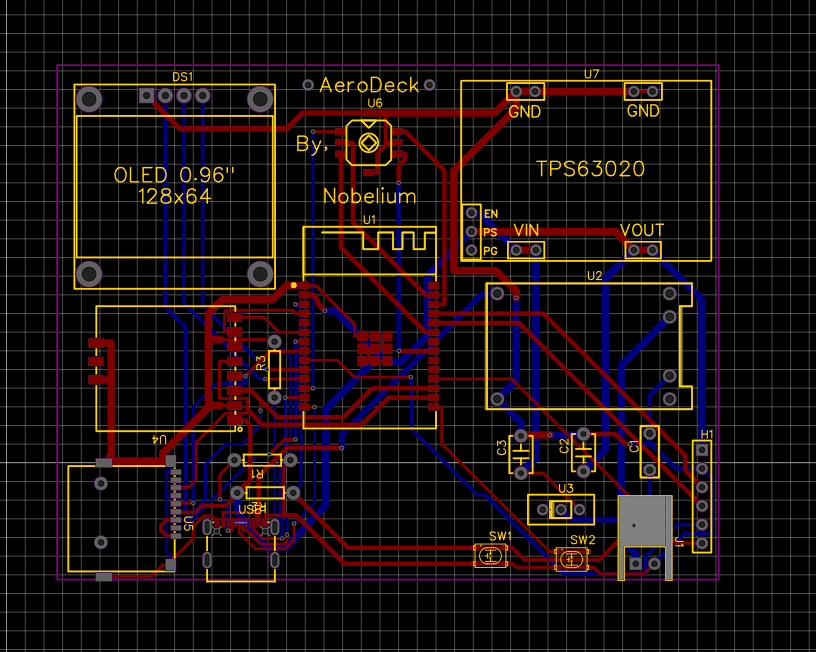

# AeroDeck
A compact, custom-designed handheld wireless and RF auditing tool that is built with the help of the ESP32-C5-WROOM-1 module and sub-1GHz radio modules for cybersecurity project

![Aerodeck PCB design]

And

---

##  Microcontroller Research & Selection
* **Why ESP32-S3 Wasn't Enough:** While popular, the ESP32-S3 fell short of the advanced power efficiency(mainly because I wanted 5GHz wifi support), modern processor architecture, and cutting-edge wireless standards required for a dedicated multi-protocol RF auditing device.
* **Selection of the ESP32-C5-WROOM-1:** After careful research and budgeting for the 65 dollar Hack Club limit, the **ESP32-C5** was chosen as the core microcontroller. It features a modern **RISC-V single-core architecture**, native support for Wi-Fi 6 (802.11ax) and Bluetooth 5, and seamless compatibility with the sub-1GHz CC1101 radio module.

---

## Schematic Design & Hardware Architecture
* **Learning Curve & Software Workflow:** Mastered EasyEDA through video tutorials and multiple initial design hurdles establishing frequent saving habits as i forgot to save the SAME PROJECT 3 TIMESSS!!!, and ensuring absolute precision in schematic capture.
* **Power Management Architecture:** Designed a robust dual-rail power system with USB Type-C port equipped with 5.1k CC resistors for power negotiation, a TP4056 battery charger, a LiPo battery, a slide switch, and a TPS63020 buck-boost regulator to maintain  3.3V rail separated safely from the 5V input.
* **Peripherals & Pin Mapping:**
 I connected all the parts with the help of Ai as i was a beginner. I figured every path and its work by ai and it made me understand and do it by my own. In the process I learnt so many things.
* **Through-Hole Component Adaptation:** Converted standard surface-mount resistors, capacitors, and switches into through-hole packages to ensure effortless hand-soldering. in the next update I will use the main dev board and header pins for more easu soldering.

---

## PCB Layout, Routing, & Manufacturing Prep
* **Component Placement:** Arranged components strategically within a compact 90x65 mm( maybe a little bit bigger as i expanded it later) double-layer board layout, keeping trace lengths as short as possible to minimize signal noise and interference.
* **Routing & Clearance Optimization:** Utilized automated tracking tools to handle initial trace generation, followed by meticulous manual routing and clearance adjustments to resolve overlapping tracks and achieve full connectivity.
* **Manufacturing Readiness:** Generated and backed up project source files alongside the final Gerber (.zip) packages, preparing the board for fabrication.
* 

## Enclosure & 3D CAD Design

For **Week 2**, a custom two-piece protective enclosure was designed in CAD to house all AeroDeck hardware components cleanly and securely and ensure a mobile device without causing wiring trouble. 

### Key Design Features:
* **Two-Piece Shell Architecture:** Designed with a main bottom housing(for keeping the battery) and a top faceplate(mostly visible from the outside) that features corner alignment tabs for secure assembly.
* **Component Cutouts:** Precise openings modeled for the 0.96-inch OLED screen, navigation switches, and external antenna and USB-C ports.
* **Internal Mounting Standoffs:** Built-in internal supports and wall channels to hold the main AeroDeck PCB and 3.7V LiPo battery firmly in place without loose movement.
* **Tolerances & Clearance:** Designed with standard 3D-printing tolerances to ensure all physical modules fit snugly upon printing.
* 

And it would be best to print the whole thing by PLA filament as it has some moving part that will snap the battery in ensuring proper connection with the mainboard.

All source CAD files (`.f3d` and `.3mf`) are available in the `/3D Files` directory.

---

## Repository Structure
* `/pcb` — The EasyEDA schematic and board layout source files(.json).
* `/gerber` — Manufacturing-ready Gerber export packages(.zip).
* `/firmware` — Starter code, pin definitions, and hardware initialization scripts for the ESP32-C5.
* `/3D Files` - The .f3d cad file, .gcode.3mf printable file

